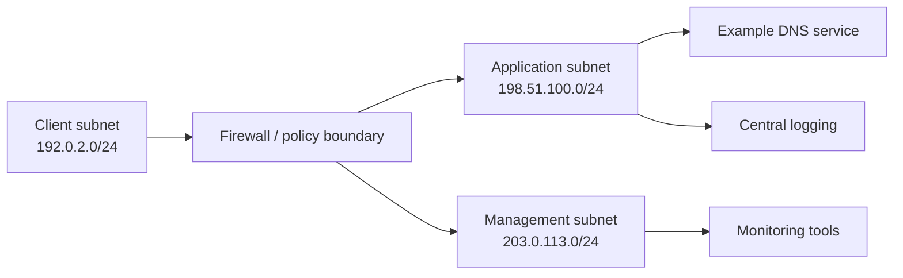

# Network Security Labs

**Enterprise networking | Network security | Segmentation | Troubleshooting**

My infrastructure and network delivery experience has involved complex enterprise environments where connectivity, security boundaries, availability and operational support must work together. This repository captures the network engineering principles I use to reason about those environments, through vendor-neutral learning exercises and synthetic examples.

The material is intended to demonstrate technical approach and structured troubleshooting. It is not a disclosure of customer network designs, configurations or production incidents.

## Engineering focus

- Understand traffic flows, trust boundaries and service dependencies before changing policy.
- Segment networks according to function, risk and ownership.
- Apply least privilege and default-deny principles where appropriate.
- Keep administrative access separate, restricted and auditable.
- Troubleshoot methodically across DNS, routing, transport and application layers.
- Maintain clear ownership, purpose, review dates and change records for firewall rules.
- Monitor permitted and denied traffic to support detection and operational assurance.

## Synthetic lab topology

The addresses shown are documentation ranges reserved for examples, not real deployment addressing.

## Learning modules

| Module | Technical area | What the exercise demonstrates |
|---|---|---|
| IP fundamentals | IPv4, CIDR and subnetting | Address planning and subnet calculations |
| Routing | Static and dynamic routing concepts | Synthetic route-table analysis |
| DNS | Resolution, records and troubleshooting | Query/response investigation |
| Segmentation | Zones, ACLs and firewall policy | Controlled allow-list policy |
| Secure access | VPN and administrative access | Threat and control review |
| Load balancing | Health checks and traffic distribution | High-level traffic-flow reasoning |
| Packet analysis | TCP, TLS and DNS | Sanitised protocol analysis |
| Monitoring | Flow logs and security events | Detection use cases |

## Published labs and templates

- [Lab 01 — Segmentation design](labs/01-segmentation-design/README.md)
- [Lab 02 — DNS troubleshooting](labs/02-dns-troubleshooting/README.md)
- [Lab 03 — Wireshark protocol analysis](labs/03-wireshark-analysis/README.md)
- [Firewall rule review template](templates/FIREWALL-RULE-REVIEW.csv)
- [Network security review checklist](docs/NETWORK-SECURITY-REVIEW.md)

## Example firewall governance checks

- [ ] Identify the source, destination, service and business owner.
- [ ] Record the purpose and justification for each rule.
- [ ] Restrict access to the minimum required paths and ports.
- [ ] Separate user, application, server and management trust zones.
- [ ] Record expiry or review dates for temporary access.
- [ ] Log policy decisions and monitor unusual traffic.
- [ ] Test both permitted and explicitly denied flows.
- [ ] Link changes to an approved change record.

## Packet-analysis workflow

1. Capture only traffic you own or are authorised to inspect.
2. Use a lab environment and synthetic traffic wherever possible.
3. Identify endpoints, protocol, ports and connection state.
4. Correlate DNS lookups, TCP handshakes and TLS negotiation.
5. Record findings without publishing payloads, tokens or personal data.

## Responsible use

All topologies, packet captures, IP addresses and hostnames must be synthetic or explicitly cleared for public use. No live scanning, interception or configuration changes should be performed without explicit authorisation. The labs demonstrate learning and technical methodology; they should not be mistaken for evidence of a specific customer deployment.
