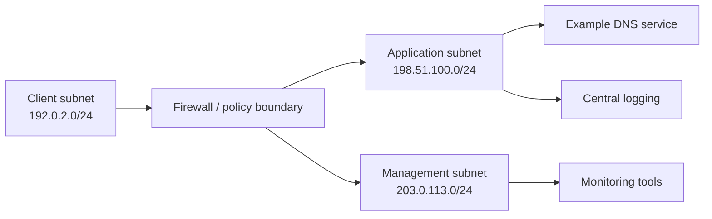

# Network Security Labs

**Enterprise networking | Segmentation | Troubleshooting | Security controls**

Vendor-neutral labs for learning, documenting and demonstrating enterprise networking and infrastructure security.

All topologies, packet captures, IP addresses and hostnames must be synthetic or explicitly cleared for public use.

## Lab topology

The addresses above are documentation ranges reserved for examples; they are not intended for real network deployment.

## Learning modules

| Module | Topics | Demonstration |
|---|---|---|
| IP fundamentals | IPv4, CIDR, subnetting | Address plan and subnet calculations |
| Routing | Static and dynamic routing concepts | Synthetic route table analysis |
| DNS | Resolution, records, troubleshooting | Query and response walkthrough |
| Segmentation | Zones, ACLs, firewall policies | Allow-list policy example |
| Secure access | VPN and administrative access | Threat and control review |
| Load balancing | Health checks and traffic distribution | High-level traffic flow |
| Packet analysis | TCP, TLS and DNS observations | Sanitized capture analysis |
| Monitoring | Flow logs and security events | Detection use cases |

## Security review checklist

- [ ] Identify trust zones and traffic owners.
- [ ] Default-deny between zones; add only justified flows.
- [ ] Separate administrative and user access paths.
- [ ] Protect management interfaces and restrict source networks.
- [ ] Log policy decisions and monitor unusual traffic.
- [ ] Review DNS, NTP and certificate dependencies.
- [ ] Document rule owner, purpose, expiry/review date and change record.
- [ ] Test both permitted and explicitly denied flows.

## Packet-analysis workflow

1. Capture only traffic you own or are authorized to inspect.
2. Use a lab environment and synthetic traffic where possible.
3. Identify endpoints, protocol, ports and connection state.
4. Correlate DNS lookups, TCP handshakes and TLS negotiation.
5. Record findings without publishing payloads, tokens or personal data.

## Published labs and templates

- [Lab 01 — Segmentation design](labs/01-segmentation-design/README.md)
- [Lab 02 — DNS troubleshooting](labs/02-dns-troubleshooting/README.md)
- [Lab 03 — Wireshark protocol analysis](labs/03-wireshark-analysis/README.md)
- [Firewall rule review template](templates/FIREWALL-RULE-REVIEW.csv)
- [Network security review checklist](docs/NETWORK-SECURITY-REVIEW.md)

## Roadmap

- [x] Publish a synthetic firewall segmentation exercise
- [x] Add DNS troubleshooting examples
- [x] Add Wireshark protocol walkthrough
- [x] Add a firewall rule review template
- [x] Add a network security review checklist

All labs require authorization and must use synthetic or explicitly approved data. No live scanning or interception is permitted without explicit authorization.
