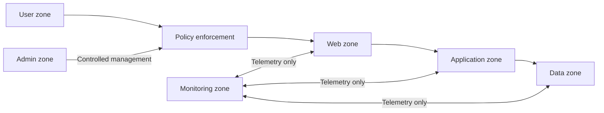

# Lab 01 — Enterprise Network Segmentation

## Objective
Design trust zones and a minimal communication policy for a fictional enterprise application.

## Synthetic topology

## Example policy matrix

| Source | Destination | Service | Decision | Rationale |
|---|---|---|---|---|
| User zone | Web zone | HTTPS | Allow | User application access |
| Web zone | Application zone | Approved app port | Allow | Required application flow |
| Application zone | Data zone | Approved DB port | Allow | Required data access |
| User zone | Data zone | Any | Deny | Prevent direct data-tier access |
| User zone | Management zone | Any | Deny | Separate administrative plane |
| Admin zone | Managed assets | Approved management protocol | Conditional allow | Restricted admin access |

The actual ports and source/destination ranges must be established from requirements and approved locally; do not infer them from this example.

## Exercise
1. Identify assets, data classification and trust boundaries.
2. List business-required flows and accountable owners.
3. Apply default-deny between zones.
4. Define logging, review date and expiry for exceptions.
5. Test allowed and denied traffic.
6. Review rule recertification and unused rules.

## Deliverables
- Logical zone diagram
- Communication matrix
- Rule justification register
- Test evidence and exceptions log

Use synthetic IP ranges only. Do not publish real firewall exports or internal network maps.
